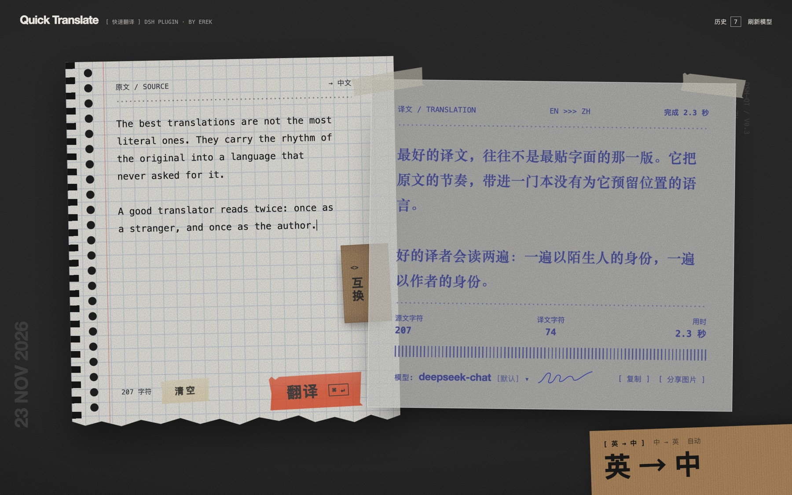
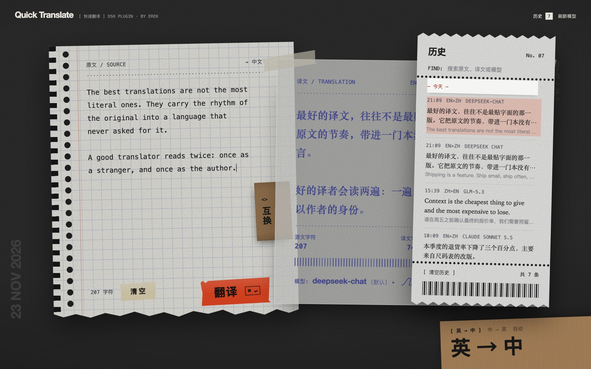
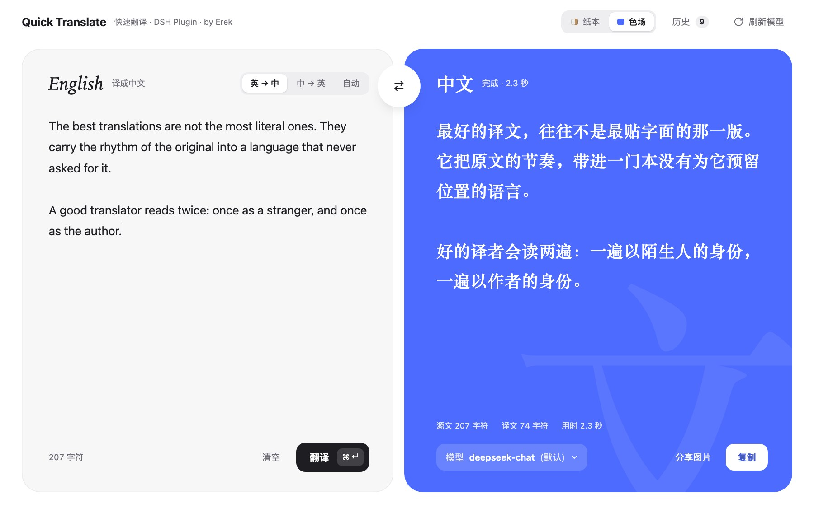
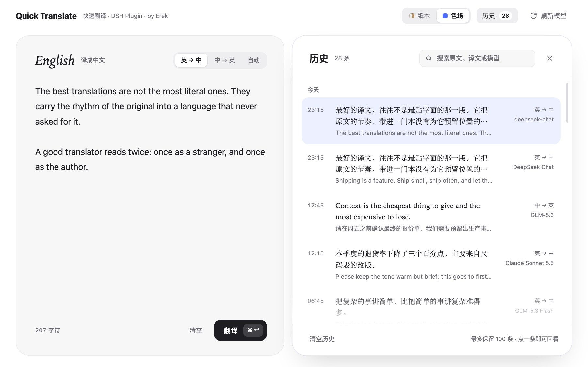
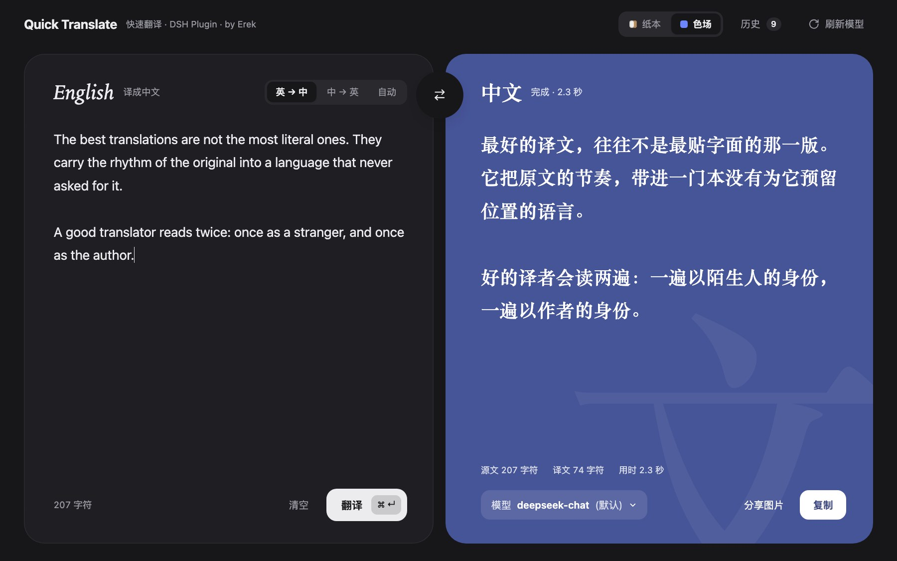

# 快速翻译 · DeepSeek Harness 插件

中英互译是很频繁的需求，在应用和网页之间来回切换，亦或是打开Agent窗口输入“翻译：XXX”，也很烦，我既不想打开一个网页，也不想安装一个新软件，索性在DSH里做了一个插件。

本插件直接调用你在 DSH「设置 › 模型」中已配置的模型，不需要另外填写 API Key。粘贴原文后按 ⌘ + Enter，译文会边生成边显示。翻译结果也可以生成一张分享图片。

界面提供两种风格，可在右上角随时切换：

- **纸本**：原文写在方格本上，译文印在覆于其上的半透明纸上，带一点手账的质感。
- **色场**：简洁版。原文在左，译文在右侧的整块色面上，配色跟随 DSH 的浅色 / 深色主题，适合只关注翻译本身的使用场景。

### 纸本





### 色场







## 安装

### 方式一：插件市场

在 DSH 的插件市场中搜索「快速翻译」或 `dsh-quick-translate`，点击安装。

插件目前正在申请上架，如果市场中暂时搜索不到，请使用方式二。

### 方式二：通过包名安装

插件已发布到 npm，可在 DSH 中直接安装：

1. 打开 DSH「设置 › 插件」，点击「添加插件」。
2. 选择「安装第三方插件」。
3. 在「包名或地址」中填写 `dsh-quick-translate`，点击「安装」。

如提示需要重启，重启 DSH 后，左侧栏会出现「快速翻译」图标。

在国内下载较慢时，可在安装前将「安装源」切换为「中国大陆镜像源」。

### 手动安装

以上两种方式都不便使用时，可以选择以下任一方式。

**安装本地文件夹**

先将仓库下载到本地：

```bash
git clone https://github.com/erek303/dsh-quick-translate.git
```

再进入「设置 › 插件 › 添加插件 › 安装第三方插件」，在「包名或地址」中填写该文件夹的完整路径，例如 `/Users/你的用户名/dsh-quick-translate`。

**由 DSH 的 agent 代为安装**

在 DSH 中新建对话，输入：

> 帮我安装插件 dsh-quick-translate

agent 会调用插件管理完成安装并反馈结果。如需安装本地文件夹，将包名替换为文件夹路径即可。

### 更新版本

DSH 不会自动更新第三方插件，有新版本时需要手动更新：

1. 打开「设置 › 插件」，点进「快速翻译」的详情页，DSH 会到 npm 检查是否有新版本。
2. 有新版本时，插件卡片上会标出「可更新」，详情页右上角出现「更新到 x.x.x」按钮，点击即可。如果没有出现，可以在详情页的「版本」中点「重新检查」。
3. 更新期间插件会短暂停止；如提示需要重启，重启 DSH 后生效。

翻译历史保存在本机，更新不会丢失。刚发布的版本，DSH 出于安全策略可能需要等待一段时间才会安装，届时再更新即可。

通过本地文件夹安装的，DSH 不会检查更新。请在该文件夹中执行 `git pull` 获取最新代码，再重启 DSH。

## 使用说明

1. 点击左侧栏的「快速翻译」图标，打开翻译界面。
2. 在左侧粘贴原文，按 **⌘ + Enter**（Windows 为 Ctrl + Enter），或点击「翻译」。
3. 翻译方向可选英译中、中译英或「自动」。「自动」会根据原文中汉字的比例判断方向。
4. 点击译文下方的模型名称可以切换模型，列表包含 DSH 中已配置的全部文字模型，默认使用 DSH 的默认模型。
5. 点击中间的互换按钮，原文与译文对调，便于回译核对；再次点击即可还原。
6. 每次完成的翻译都会存入「历史」，支持搜索、回看和删除。
7. 翻译过程中按 **Esc** 可随时中止。
8. 「复制」将译文复制到剪贴板；「分享图片」将本次原文与译文生成一张竖版图片，可复制或保存为 PNG。

## 说明

- 翻译请求只发送给你所选的模型。插件不保存任何密钥，也不会读取或修改你的会话。
- 对于带思考过程的模型，插件会自动选用最低的推理档位，以保证翻译速度。
- 单次最多翻译约 2 万字，更长的内容请分段处理。
- 中英混排的短句，「自动」可能判断有误，此时请手动选择方向。
- 历史最多保留 100 条，仅存储在本机的 DSH 中，更换电脑或清除浏览器数据后会丢失。
- 分享图片中，原文最多显示 7 行，译文最多 12 行，超出部分会被截断。

## 参与开发

界面代码在 `client.js`，模型调用在 `index.js`，`dev/harness.html` 可以在不打开 DSH 的情况下预览界面。修改后运行 `node dev/smoke.mjs`，测试全部通过后再到 DSH 中查看效果。

问题与建议欢迎提交到 [Issues](https://github.com/erek303/dsh-quick-translate/issues)。

## 作者与许可

作者 Erek · [MIT License](LICENSE)
